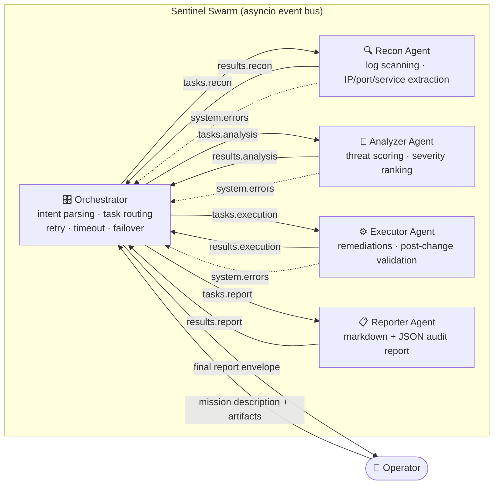
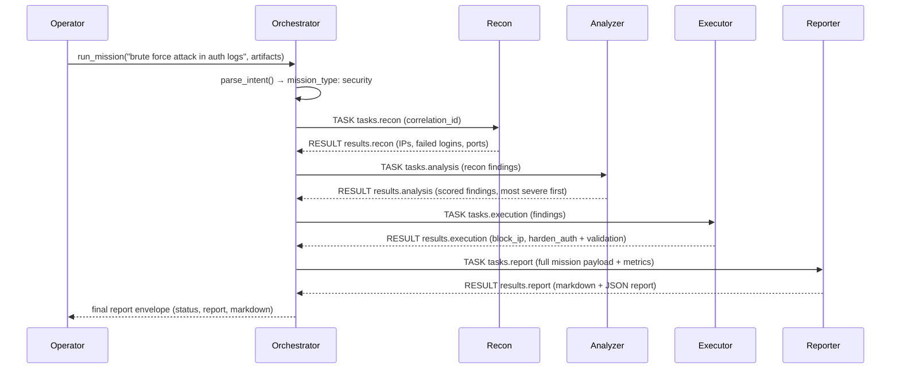
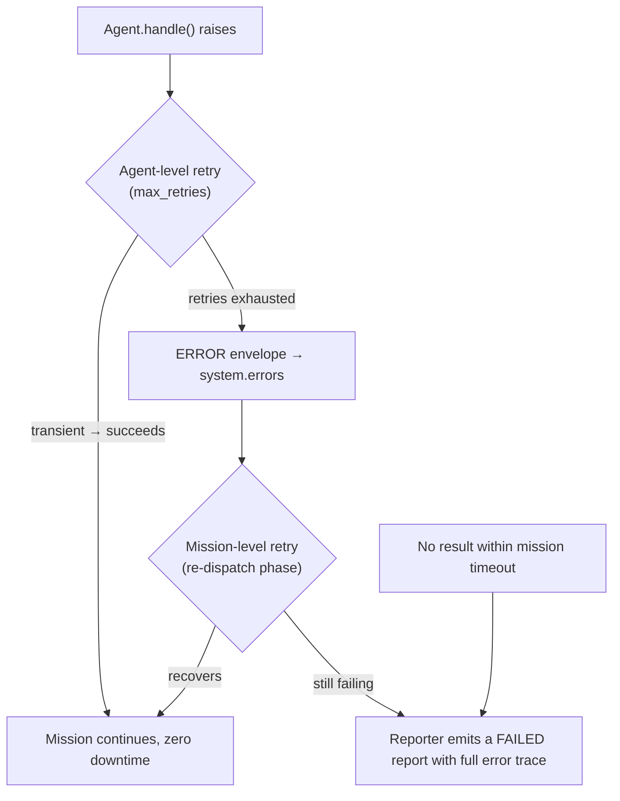

# Sentinel Swarm 🛡️

**An autonomous 5-agent security operations swarm.** Five specialized AI agents — an Orchestrator, a Recon agent, a Security Analyzer, a Remediation Executor, and an Auditor/Reporter — collaborate in real time over an async, event-driven message bus to investigate security incidents, score threats, apply remediations, and produce a full markdown + JSON audit report.

Built on pure `asyncio` with **zero runtime dependencies**.

---

## Why This Exists

Modern security operations face a firehose of raw telemetry. Sentinel Swarm demonstrates the multi-agent answer: instead of one monolithic script, five independent, single-responsibility agents that communicate asynchronously, recover from each other's failures, and never block each other. The same architecture transfers directly to software development (triage agents, test agents, review agents), data analysis, and any workflow where work must be decomposed, parallelized, and audited.

## Architecture Overview



### Mission Lifecycle (sequence)



### Error Recovery (two levels)



**Guarantee:** every mission resolves. Success produces a completed report; any failure path — crashing agent, exhausted retries, or timeout — still produces a structured failure report (with a 2-second fallback if even the reporter is down), so callers never hang.

## The Team

| Agent | Role | Responsibilities |
|-------|------|------------------|
| **Orchestrator** (`orchestrator.py`) | Manager | Parses natural-language intent into a mission type, routes tasks over the bus, tracks per-mission state, runs watchdog timeouts, retries failed phases, fails over gracefully |
| **Recon** (`recon.py`) | Researcher | Scans raw log artifacts, extracts IPs, ports, services, failed-login patterns, suspicious lines |
| **Analyzer** (`analyzer.py`) | Security analyst | Scores findings (brute-force detection, severity ranking), most severe first |
| **Executor** (`executor.py`) | Builder | Applies remediations (IP blocklists, auth hardening) and runs post-change validation checks |
| **Reporter** (`reporter.py`) | Auditor | Compiles the final audit report as markdown and JSON |

Every agent is an isolated `asyncio` task with its own inbox queue: a slow or crashing agent never blocks the rest of the swarm.

## Installation

```bash
git clone https://github.com/mehulpatel23b-pixel/sentinel-swarm.git
cd sentinel-swarm

# Python 3.10+ required
python -m venv .venv && source .venv/bin/activate

pip install -e ".[dev]"
```

## Quick Start

```python
import asyncio
from sentinel_swarm import SentinelTeam

auth_log = [
    "Oct 20 02:14:01 host sshd[101]: Failed password for root from 203.0.113.7 port 41822 ssh2",
    "Oct 20 02:14:03 host sshd[102]: Failed password for root from 203.0.113.7 port 41823 ssh2",
    # ... more lines
]

async def main():
    async with SentinelTeam() as team:
        result = await team.run(
            "Investigate the brute force attack in the auth logs",
            artifacts=auth_log,
            timeout=30.0,
        )
        print(result["status"])     # "completed"
        print(result["markdown"])   # full markdown report
        print(result["report"])    # structured dict (JSON-serialisable)

asyncio.run(main())
```

Or run the bundled demo against the sample auth log:

```bash
python examples/run_soc.py               # built-in sample
python examples/run_soc.py /var/log/auth.log
```

Sample output:

```
# Mission Report: 035317d8cf21

**Type:** security
**Status:** completed

## Findings

| ID | Severity | Title | Evidence |
|----|----------|-------|----------|
| BRUTE-203.0.113.7 | high | Brute-force attack pattern from 203.0.113.7 | 6 failed authentication attempts |

## Actions Taken
- **block_ip** -> 203.0.113.7 (applied)
- **harden_auth** -> sshd_config (applied)
```

## Running Tests

```bash
pip install -e ".[dev]"
pytest
```

31 tests cover the event bus, message envelopes, each agent's logic, and full-mission integration scenarios including:

- ✅ end-to-end mission execution (all 5 agents)
- ✅ transient agent failure → silent agent-level retry, mission still completes
- ✅ persistent agent failure → mission-level retry, then graceful failure report
- ✅ mission timeout → watchdog fires, structured failure report produced
- ✅ concurrent missions stay isolated via correlation IDs

## Building Your Own Agent

```python
from sentinel_swarm.base import BaseAgent
from sentinel_swarm.messages import Message
from sentinel_swarm.topics import Topics

class NetworkMapperAgent(BaseAgent):
    name = "mapper"
    subscribes_to = ("tasks.map",)

    async def handle(self, message: Message) -> None:
        result = self.map_hosts(message.payload["targets"])
        self.bus.publish(
            "results.map",
            Message.result(self.name, "results.map", result, message.correlation_id),
        )

# Slot it into any team
team = SentinelTeam(agents=[orchestrator, NetworkMapperAgent("mapper", bus), ...])
```

Agents only need: a `name`, topics to `subscribes_to`, and an async `handle()`. Retries, error envelopes, lifecycle, and metrics come free from `BaseAgent`.

## Real-World Use Cases

| Domain | Scenario |
|--------|----------|
| **Security ops** | Autonomous log triage: swarm scans auth logs nightly, blocks brute-forcing IPs, emails the audit report |
| **Incident response** | Feed forensic artifacts; recon extracts indicators, analyzer scores blast radius, executor isolates, reporter documents the chain of custody |
| **Software development** | Same bus + orchestrator pattern with recon→repo scanner, analyzer→static analysis, executor→auto-fixer, reporter→PR description |
| **Data analysis** | Multiple analysts process partitions concurrently; correlation IDs keep findings per-question isolated |
| **Health/ops monitoring** | Watchdog pattern generalizes to any SRE workflow where a missing response must produce an alert, not a hang |

## Design Principles

1. **Zero dependencies** — the framework is pure Python stdlib; only `pytest` for development.
2. **Event-driven, not call-driven** — agents never call each other; they publish and subscribe, so any agent can be replaced without touching the rest.
3. **Failure is a first-class citizen** — every failure mode (transient error, dead agent, timeout) has a tested recovery path.
4. **Correlation over everything** — missions, tasks, and errors share a correlation ID, enabling safe concurrent missions on one bus.
5. **Auditable by construction** — every mission ends in a structured report, success or failure.

## Project Structure

```
sentinel-swarm/
├── src/sentinel_swarm/
│   ├── bus.py                  # async pub/sub event bus
│   ├── messages.py             # Message envelope + MessageType
│   ├── topics.py               # canonical topic registry
│   ├── base.py                 # BaseAgent: retries, errors, lifecycle
│   ├── reports.py              # Report model (markdown/JSON)
│   ├── team.py                 # SentinelTeam: 5-agent assembly
│   └── agents/
│       ├── orchestrator.py     # intent parsing, routing, watchdog
│       ├── recon.py            # log scanning + data extraction
│       ├── analyzer.py         # threat scoring
│       ├── executor.py         # remediation + validation
│       └── reporter.py         # audit reporting
├── tests/                      # 31 tests incl. error-recovery scenarios
├── examples/run_soc.py         # CLI demo
├── pyproject.toml
├── LICENSE (MIT)
└── README.md
```

## License

MIT — see [LICENSE](LICENSE).

---

> Part of a daily series exploring high-impact multi-agent architectures. Built autonomously by [Susu](https://app.base44.com/superagent/6ad3127297a1ac600263af7b), the author's personal AI agent.
